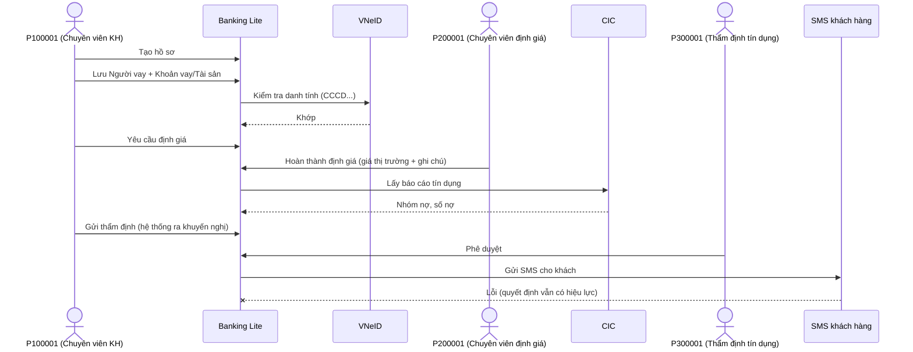
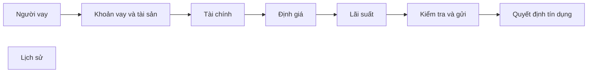
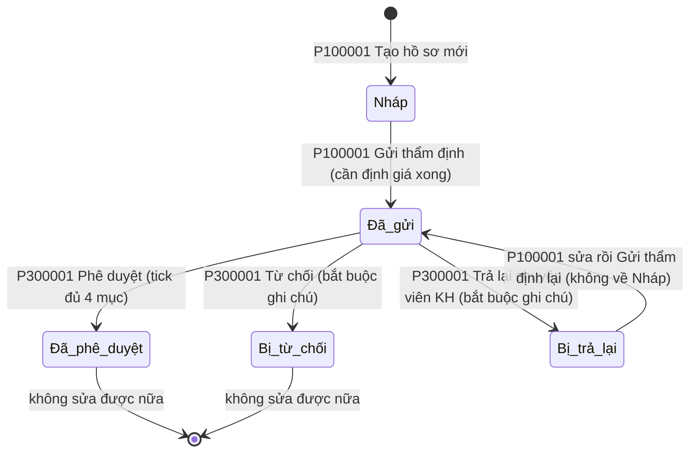

# Báo cáo khám phá Banking Lite (v2 — đã chạy hết vòng đời hồ sơ: Phê duyệt / Từ chối / Trả lại → gửi lại, với 3 tài khoản)

Cập nhật: 2026-11-17 · Hệ thống: https://banking-lite.vercel.app/ (Phiên bản 1.3.0) · Ngôn ngữ giao diện: Tiếng Việt / English

> **Nguyên tắc:** chỉ ghi điều đã **nhìn thấy trên màn hình**. Điều chưa kiểm chứng ghi rõ "❓ chưa xác nhận".
> Ảnh bằng chứng: thư mục [screenshots/](screenshots/).

## 1. Tiến độ

| Tài khoản | Vai trò hiển thị | Trạng thái khám phá |
|---|---|---|
| P100001 | Chuyên viên khách hàng (DEFAULT) | Đã xem danh sách + 8 bước HL-000011 (chỉ đọc); tạo hồ sơ mới, nhập liệu (kể cả dữ liệu sai), yêu cầu định giá, gửi thẩm định (mục 3.5, 3.6); "Tạo từ hồ sơ có sẵn" + dùng lại định giá (3.7); sửa và gửi lại hồ sơ bị trả lại (3.8). Chưa thử: Hủy yêu cầu định giá, Thêm người vay |
| P200001 | **Chuyên viên định giá** (đã xác nhận trên giao diện) | Đã xem danh sách, quyền chỉ-xem, và hoàn thành định giá HL-000019 (mục 3b) |
| P300001 | **Chuyên viên thẩm định tín dụng** (đã xác nhận trên giao diện) | Đã xem danh sách, trang Tích hợp; đã Phê duyệt (HL-000019), Từ chối (HL-000020), Trả lại (HL-000021) — mục 3c, 3c.2. Chưa tải CSV (cần bạn đồng ý) |

## 2. Hệ thống là gì

"Banking Lite — **Vay mua nhà**": ứng dụng xử lý **hồ sơ vay mua nhà** (mã dạng `HL-000018`). Một hồ sơ đi qua các bước: nhập người vay → khoản vay & tài sản → tài chính → định giá tài sản → chọn lãi suất → kiểm tra & gửi → quyết định tín dụng → lịch sử.

Đăng nhập: **Mã nhân viên** (chữ P + 6 chữ số) + **Mật khẩu**. Ảnh: `01-login-page-vi.jpg`.

## 3. P100001 — Chuyên viên khách hàng

### 3.1 Màn hình "Danh sách việc" (ảnh `02`)
- Thanh trên: tên hệ thống, link "Danh sách việc", mã + vai trò người dùng (`P100001 · Chuyên viên khách hàng · DEFAULT`), chuyển Tiếng Việt/English, Đăng xuất.
- Hai nút: **Tạo hồ sơ mới** (mục 3.5) và **Tạo từ hồ sơ có sẵn** (mục 3.7).
- Hai tab: **Hồ sơ của tôi** (hồ sơ do P100001 tạo) và **Tất cả hồ sơ** (có cả hồ sơ của người khác, ví dụ HL-000012 do **P100002** tạo → tồn tại thêm tài khoản P100002).
- Cột: Mã hồ sơ, Người vay chính, Số tiền vay, Trạng thái, Định giá, Người tạo, Cập nhật.
- Tải tab "Tất cả hồ sơ" mất vài giây (hiện "Đang tải…").

Các giá trị đã thấy:
- **Trạng thái hồ sơ:** Nháp, Đã gửi, Bị trả lại, Đã phê duyệt, Bị từ chối.
- **Trạng thái định giá:** Chưa yêu cầu, Đã yêu cầu, Đã hoàn thành, Đã hủy.

### 3.2 Mở một hồ sơ — ví dụ HL-000011 (Đã phê duyệt) (ảnh `03`–`10`)
- Khung tóm tắt: Mã hồ sơ, Trạng thái, Người vay, Số tiền vay, LTV, Kỳ trả đầu tiên, Khuyến nghị, Chuyên viên.
- Hồ sơ đã phê duyệt hiện thông báo: **"Hồ sơ đã phê duyệt. Không thể thay đổi nữa."**
- Thanh bước (mỗi bước có link riêng, ví dụ `/applications/<id>/borrowers`, `/loan`, `/financials`, `/valuation`, `/pricing`, `/review`, `/decision`, `/history`).

| Bước | Nội dung quan sát được | Ảnh |
|---|---|---|
| Người vay | Dòng "Danh tính được kiểm tra với **VNeID** khi bạn lưu"; trường: Họ tên*, Số CCCD* (12 chữ số), Ngày sinh*, SĐT di động* (10 số, bắt đầu 0), Tỉnh/thành*, Địa chỉ; nhãn "Người vay A1 · Người vay chính"; "VNeID: khớp" | `03` |
| Khoản vay và tài sản | Mục đích (Mua nhà / Xây-sửa nhà), Sản phẩm*, Số tiền vay*, Thời hạn (năm)*, Thời gian ân hạn (tháng), Phương thức trả nợ (Gốc đều / Niên kim); Tài sản bảo đảm: Tỉnh/thành*, Địa chỉ*, Số giấy chứng nhận, Giá trị khai báo*; khối "Ước tính trả nợ" | `05` |
| Tài chính | Lương, Thu nhập cho thuê (tính **70%** vào khả năng trả nợ), Chi phí sinh hoạt, Khoản trả nợ hiện có, Số người phụ thuộc; khối "Thẩm định" (LTV, DSR, thặng dư, tuổi cao nhất khi đáo hạn…) | `04` |
| Định giá | Địa chỉ, Số GCN, Giá trị khai báo, Trạng thái định giá (ai yêu cầu, ngày), Giá trị thị trường (ai hoàn thành, ngày), Ghi chú | `06` |
| Lãi suất | Ô "Giảm biên độ (điểm phần trăm)" tối đa 0,5; bảng so sánh sản phẩm; chi tiết biên độ; lịch trả nợ theo kỳ | `07` |
| Kiểm tra và gửi | "Ước tính trả nợ" + khối "Thẩm định: Phê duyệt" + "Lý do" | `08` |
| Quyết định tín dụng | Thẩm định + Lý do + **Báo cáo tín dụng CIC** + dòng "P300001 quyết định phê duyệt ngày …" | `09` |
| Lịch sử | Nhật ký thao tác, mới nhất ở trên | `10` |

### 3.3 Số liệu & quy tắc quan sát được (HL-000011)
- Vay 2.000.000.000 VND, tài sản khai báo 4.000.000.000 → **LTV 50%** (hiển thị "LTV tối đa 80,00%").
- 3 sản phẩm "Mua nhà": cố định 6,00%/12 tháng; 7,00%/24 tháng; 7,80%/36 tháng. Lãi suất sau ưu đãi tương ứng 9,80% / 9,50% / 9,30%.
- Khoản trả mới theo lãi suất thẩm định 24.666.667; thu nhập được tính 78.100.000 (= 64.100.000 lương + 70% × 20.000.000 thuê); DSR 31,58%; thặng dư 38.433.333.
- Khuyến nghị: Phê duyệt — lý do "Đáp ứng mọi quy tắc tín dụng."
- Lịch trả nợ: hiện 24 kỳ đầu, kèm "Hiện đủ 240 tháng" (❓ chưa rõ nút xem đủ ở đâu).
- ❓ Công thức chi tiết (biên độ 3,30; cộng thêm theo LTV; ngưỡng DSR…) chưa biết quy tắc gốc — cần tài liệu hoặc thử các ca biên.

### 3.4 Lịch sử HL-000011 (end-to-end đã xảy ra, đọc từ nhật ký — ảnh `10`)
1. Tạo hồ sơ — P100001
2. Lưu thông tin (Người vay, Khoản vay và tài sản) — P100001
3. Kiểm tra danh tính với VNeID — P100001 (A1: khớp)
4. Yêu cầu định giá — P100001
5. Hoàn thành định giá — P200001
6. Nhận báo cáo CIC — P100001
7. Gửi thẩm định — P100001 (kết quả: Phê duyệt)
8. Phê duyệt — P300001
9. Gửi SMS cho khách hàng — P300001 (**gửi lỗi, quyết định vẫn có hiệu lực**)

### 3.5 Thử luồng tạo hồ sơ mới — HL-000019 (P100001, đã được người dùng đồng ý, dữ liệu test)

Các bước đã làm và kết quả thật trên màn hình:

| # | Thao tác | Kết quả quan sát | Ảnh |
|---|---|---|---|
| 1 | Danh sách việc → bấm **Tạo hồ sơ mới** | Hệ thống **tạo ngay** hồ sơ nháp `HL-000019` (chưa nhập gì), mở bước Người vay. Các bước 2,3,4,5,7 hiện "Chưa mở"; bước 1 và 6 "Còn thiếu thông tin". Chuyên viên = P100001 | `12` |
| 2 | Bước Người vay: để trống, bấm **Lưu và tiếp tục** | Chuyển sang bước 2 nhưng bước 2 **bị khóa**: "Bước này mở sau khi hoàn thành: Người vay". Không thấy thông báo lỗi ở form | `13` |
| 3 | Nhập CCCD `123`, SĐT `123` (sai định dạng), bấm **Lưu** | Báo **"Đã lưu."**, không có lỗi chữ đỏ; VNeID hiện "Chưa kiểm tra"; bước 1 vẫn "Còn thiếu thông tin" | `11` |
| 4 | Nhập CCCD 12 số + SĐT 10 số bắt đầu 0, bấm **Lưu** | "Đã lưu."; nhãn VNeID chuyển thành **"VNeID: khớp"** (kiểm tra danh tính chạy khi lưu) | `14` |
| 5 | Bước Khoản vay: vay 3,4 tỷ / tài sản 4 tỷ (LTV 85%) | Vẫn lưu được. "Ước tính trả nợ": LTV 85%, lãi sau ưu đãi **10,30%** (so với 9,80% ở LTV 50% → có cộng thêm theo LTV) | `15` |
| 6 | Bước Tài chính: lương 64,1tr, chi phí 15tr, nợ 0, phụ thuộc 1 | Khối "Thẩm định" xem trước: **Từ chối** — lý do "LTV 85% vượt mức tối đa 80%" và "Chuyển cấp trên: DSR 67,63% vượt 50%". Ghi chú: "thẩm định chính thức chạy khi gửi, có dữ liệu CIC" | `16` |
| 7 | Quay lại bước Khoản vay, sửa vay còn 2 tỷ (LTV 50%), lưu | Dữ liệu cũ vẫn còn khi mở lại (đã lưu). Xem trước thẩm định → **Phê duyệt**, DSR 38,48%, thặng dư 24.433.333 | — |
| 8 | Bước Định giá: trạng thái "Chưa yêu cầu" → bấm **Yêu cầu định giá** | Trạng thái → "Đã yêu cầu — P100001 yêu cầu ngày 17/11/26", bước hiện "Đang chờ xử lý", xuất hiện nút **Hủy yêu cầu định giá** | `17`, `18` |
| 9 | Bước Kiểm tra và gửi | Nút **Gửi thẩm định đang bị khóa**, thông báo "Cần hoàn thiện các mục sau trước khi gửi: Kết quả định giá đã hoàn thành. Đến bước Định giá" | — |

**Điểm đáng chú ý cho tester (cần team xác nhận có đúng thiết kế không):**
- Form lưu được với CCCD/SĐT sai định dạng và không hiện lỗi cụ thể (chỉ có gợi ý "12 chữ số", "10 chữ số, bắt đầu bằng 0" dưới ô).
- Bấm "Tạo hồ sơ mới" là tạo luôn bản ghi (đây có thể là lý do có nhiều hồ sơ nháp trống HL-000013…HL-000018).
- LTV 85% vẫn nhập và lưu được ở bước nhập liệu; chỉ phần Thẩm định xem trước báo "Từ chối".

**Chặn tiếp theo (đã gỡ):** HL-000019 chờ định giá → P200001 đã hoàn thành (mục 3b) → P100001 có thể gửi thẩm định.

### 3.6 P100001 gửi thẩm định HL-000019 (sau khi P200001 hoàn thành định giá)

| # | Thao tác | Kết quả | Ảnh |
|---|---|---|---|
| 1 | Mở bước Kiểm tra và gửi | Nút **Gửi thẩm định** đã mở; thông báo "Hồ sơ đã đầy đủ và sẵn sàng gửi."; xem trước thẩm định: Phê duyệt | — |
| 2 | Bấm **Gửi thẩm định** | Trạng thái → **Đã gửi**; thông báo **"Hồ sơ đã gửi và bị khóa trong khi chuyên viên thẩm định ra quyết định."**; nút Gửi biến mất, hiện nhãn "Đã gửi"; bước Quyết định tín dụng "Đang chờ xử lý" | `24` |
| 3 | Bước Quyết định tín dụng | Hiện kết quả thẩm định chính thức: **Phê duyệt**, lý do "Đáp ứng mọi quy tắc tín dụng."; thêm khối **Báo cáo tín dụng CIC: "A1: nhóm nợ 1, trả nợ 0 VND"** (dữ liệu CIC chỉ xuất hiện sau khi gửi). Chưa có dòng quyết định của người phê duyệt | `25` |
| 4 | Bước Lịch sử | Có thêm 2 dòng cùng lúc 10:58: "Nhận báo cáo CIC · P100001" và "Gửi thẩm định · P100001 — Phê duyệt". Mỗi lần bấm **Lưu** ở các bước nhập liệu đều sinh một dòng "Lưu thông tin" (nhãn ghi "Người vay, Khoản vay và tài sản") | `26` |

Hồ sơ chờ **người phê duyệt (nhiều khả năng P300001)** ra quyết định.

### 3.7 "Tạo từ hồ sơ có sẵn" + dùng lại định giá (P100001, tạo HL-000020 và HL-000021)

Bấm **Tạo từ hồ sơ có sẵn** trên Danh sách việc → mở khung "Chọn khách hàng làm người vay A1, chọn tài sản, hoặc cả hai" (ảnh `34`):
- **Tìm khách hàng có sẵn** (đủ 12 số CCCD hoặc một phần họ tên): gõ `Tester` → ra "Tester Mot · ********0001 · 15/5/90 · Thành phố Hà Nội · gần nhất ở HL-000019" + nút **Dùng**.
- **Tìm tài sản có sẵn** (một phần số GCN hoặc địa chỉ, ≥3 ký tự): gõ `CT 100019` → ra tài sản kèm "4.000.000.000 VND · định giá 4.000.000.000 VND ngày 17/11/26 (HL-000019)" + **Dùng**.
- Nút **Tạo hồ sơ** mờ đến khi chọn ít nhất một mục; chọn xong hiện "✓ Đã chọn: …".
- Kết quả hồ sơ mới (HL-000020, HL-000021): bước **Người vay = Đã xong** (điền sẵn từ khách hàng cũ, đã xác thực VNeID); tài sản điền sẵn (địa chỉ, số GCN, giá khai báo 4 tỷ); **Số tiền vay để trống**, Thời hạn 20, Sản phẩm 6,00%/12 tháng; bước Tài chính để trống (không sao chép thu nhập).
- **Dùng lại định giá (ảnh `35`)**: ở HL-000020 bấm **Yêu cầu định giá** → trạng thái **Đã hoàn thành ngay**, "Giá trị thị trường 4.000.000.000 VND — **Dùng lại từ hồ sơ HL-000019**". **Không cần P200001** (đúng với dòng "kết quả định giá của cùng tài sản trong 90 ngày gần nhất sẽ được dùng lại").

**LTV 85% vẫn gửi được (ảnh `36`)** — HL-000021: vay 3,4 tỷ, LTV 85%. Đầu trang hiện **Khuyến nghị: Từ chối**; bước Kiểm tra và gửi vẫn báo "Hồ sơ đã đầy đủ và sẵn sàng gửi" và nút **Gửi thẩm định** **không bị khóa**. Đã gửi → trạng thái **Đã gửi**. (❓ cần team xác nhận: hồ sơ khuyến nghị Từ chối có được phép gửi không.)

Hai hồ sơ đã gửi đang chờ P300001: **HL-000020** (khuyến nghị Phê duyệt → sẽ thử *Từ chối* thủ công) và **HL-000021** (khuyến nghị Từ chối → sẽ thử *Trả lại chuyên viên khách hàng*).

### 3.8 P100001 xử lý hồ sơ bị trả lại — HL-000021

| # | Thao tác | Kết quả | Ảnh |
|---|---|---|---|
| 1 | Mở HL-000021 (Bị trả lại) | Danh sách việc hiện nhãn **Bị trả lại** (cam). Trong hồ sơ: banner vàng **"Chuyên viên thẩm định đã trả lại hồ sơ. Ghi chú: …"**; hồ sơ **mở khóa, sửa lại được** (nút Gửi thẩm định hiện, không bị khóa) | `40` |
| 2 | Sửa Số tiền vay 3,4 tỷ → 2 tỷ, bấm Lưu | Lưu được; LTV đầu trang đổi thành 50%, nhưng **Khuyến nghị ở đầu trang vẫn là "Từ chối"** (cũ) và trạng thái vẫn **Bị trả lại** — chỉ cập nhật khi gửi lại. Khối thẩm định xem trước ở "Kiểm tra và gửi" đã chuyển thành Phê duyệt | — |
| 3 | Bấm **Gửi thẩm định** lần nữa | Trạng thái → **Đã gửi** (bị khóa lại), banner ghi chú trả lại **biến mất**, **Khuyến nghị cập nhật thành Phê duyệt**; hồ sơ quay lại hàng chờ của P300001 | `41` |

Kết luận vòng đời: Nháp → Đã gửi → **Bị trả lại** → (P100001 sửa) → Đã gửi lại → … Không cần yêu cầu định giá lại (đã có kết quả định giá).

⚠️ Điểm cần team xác nhận: khi hồ sơ bị trả lại và đã sửa lưu, ô "Khuyến nghị" ở đầu trang bị **cũ** (vẫn "Từ chối" dù LTV đã 50%) cho đến khi gửi lại.

## 3b. P200001 — Chuyên viên định giá (đã đăng nhập, đã xác nhận vai trò trên giao diện)

Thanh trên hiển thị: `P200001 · Chuyên viên định giá · DEFAULT`.

**Danh sách việc** (ảnh `19`): **không có** nút "Tạo hồ sơ mới" / "Tạo từ hồ sơ có sẵn". Có tab **Chờ định giá** (hiện HL-000019 và HL-000002 — đều "Định giá: Đã yêu cầu") và tab **Tất cả hồ sơ** (thấy toàn bộ hồ sơ, kể cả của P100001/P100002).

**Quyền trên hồ sơ** (ảnh `21`, `23`):
- Mở hồ sơ thấy đủ các bước nhưng hiện thông báo **"Bạn được xem nhưng không được sửa hồ sơ này."**; các ô ở Người vay/Khoản vay/… chỉ đọc.
- Bước **Kiểm tra và gửi**: không có nút "Gửi thẩm định" (chỉ có "Tiếp tục →"); bước **Quyết định tín dụng** hiện "Hồ sơ chưa được gửi."
- Chỉ bước **Định giá** có form riêng khi hồ sơ ở trạng thái "Đã yêu cầu": **Giá trị thị trường (VND)\*** và **Ghi chú định giá**, nút **Hoàn thành định giá**.

**Luồng đã làm với HL-000019:**

| # | Thao tác | Kết quả | Ảnh |
|---|---|---|---|
| 1 | Để trống Giá trị thị trường, bấm Hoàn thành định giá | Khung đỏ: "Một số giá trị không hợp lệ." + dòng **`validation.too_small (marketValue)`** — hiện **mã lỗi thô**, chưa được dịch ra câu tiếng Việt | `20` |
| 2 | Gõ chữ `abc` vào Giá trị thị trường | Ô không nhận chữ (giá trị trống), vẫn báo lỗi như trên |  |
| 3 | Nhập 4.000.000.000 + ghi chú, bấm Hoàn thành định giá | "Đã lưu."; Trạng thái định giá **Đã hoàn thành**; hiện "P100001 yêu cầu ngày …", "P200001 hoàn thành ngày …"; bước Định giá "Đã xong" | `22` |
| 4 | Mở lại bước Kiểm tra và gửi | Thông báo **"Hồ sơ đã đầy đủ và sẵn sàng gửi."** — nhưng P200001 không có nút gửi | — |

**Bước tiếp theo:** P100001 đăng nhập lại để bấm **Gửi thẩm định** cho HL-000019.

## 3c. P300001 — Chuyên viên thẩm định tín dụng (đã đăng nhập, xác nhận vai trò trên giao diện)

Thanh trên: `P300001 · Chuyên viên thẩm định tín dụng · DEFAULT`. Thanh menu có thêm **Tích hợp** (P100001/P200001 không thấy).

**Danh sách việc** (ảnh `27`): không có nút tạo hồ sơ; có nút **Tải báo cáo (CSV)** (❓ chưa bấm — tải file cần bạn đồng ý); tab **Chờ quyết định** (các hồ sơ "Đã gửi": HL-000019, HL-000009, HL-000008) và tab **Tất cả hồ sơ**.

**Trang Tích hợp** (`/integrations`, ảnh `28`):
- 3 thẻ trạng thái: **VNeID (định danh)**, **CIC (thông tin tín dụng)**, **Cổng SMS** — cả 3 đều "Hoạt động"; nút **Làm mới**.
- **Nhật ký gọi**: 200 lần gọi gần nhất; CCCD và SĐT bị che (`********0001`, `091****678`); lọc theo hệ thống. Cột: Thời điểm, Hệ thống, Thao tác, Mã hồ sơ, Đối tượng, Kết quả.
- Các kết quả đã thấy: VNeID = *Khớp / Thông tin không khớp / Không tìm thấy*; CIC = *Nhóm nợ 1 / 2 / 4*; SMS = *Đã gửi / Gửi lỗi*. HL-000012 (CIC nhóm nợ 4) → "SMS: từ chối" và hồ sơ **Bị từ chối**.
- Chỉ ghi nhận lần gọi VNeID **hợp lệ** của HL-000019 (10:45); các lần lưu CCCD `123` không sinh dòng nhật ký.

**Form Quyết định tín dụng** của hồ sơ "Đã gửi" (ảnh `29`, `30`):
- Hiện kết quả thẩm định + báo cáo CIC, rồi **Danh mục kiểm tra** 4 ô: đã xem kết quả kiểm tra danh tính / báo cáo CIC / kết quả định giá / thu nhập và chi phí.
- **Quyết định** (mặc định chọn *Phê duyệt*): Phê duyệt · Từ chối · Trả lại chuyên viên khách hàng; ô **Ghi chú**; nút **Ghi nhận quyết định**.

| # | Thao tác | Kết quả | Ảnh |
|---|---|---|---|
| 1 | Bấm Ghi nhận quyết định khi chưa tick danh mục | Khung đỏ: "Không thể ghi nhận quyết định. **Đánh dấu đủ danh mục kiểm tra trước khi phê duyệt.**" (có câu tiếng Việt, khác lỗi thô ở form định giá) | `30` |
| 2 | Tick đủ 4 ô, chọn Phê duyệt, nhập ghi chú, bấm Ghi nhận | Hiện "P300001 quyết định phê duyệt ngày 11:00 17/11/26" + nội dung ghi chú + nhãn "Phê duyệt" | `31` |
| 3 | Xem lại đầu trang | Trạng thái **Đã phê duyệt**; thông báo "Hồ sơ đã phê duyệt. Không thể thay đổi nữa."; mọi bước ✓ | `32` |
| 4 | Lịch sử + Tích hợp | Thêm "Phê duyệt · P300001 — ghi chú" và "Gửi SMS cho khách hàng · P300001 — **đã gửi**"; nhật ký tích hợp có "SMS: phê duyệt · HL-000019 · 091****678 · Đã gửi" | `32`, `28` |

**Giao diện English** (ảnh `33`, thử bằng P300001): toàn bộ nhãn đổi sang tiếng Anh ("Worklist", "Integrations", "Credit assessor", "Home loans", "Awaiting decision", "Submitted", "Completed"); số tiền đổi sang dạng `2,000,000,000 VND` (dấu phẩy), ngày giờ thành `17/11/2026, 07:26` (vẫn ngày/tháng/năm). Sau khi phê duyệt, HL-000019 biến khỏi tab "Awaiting decision" (còn HL-000008, HL-000009). Ở độ rộng cửa sổ hẹp, bảng bị tràn ngang (có thanh cuộn ngang). Tên người vay không dịch ("Nguyễn Văn Thử 09"). Đã chuyển lại Tiếng Việt.

⚠️ Lưu ý: SMS báo "Đã gửi" tới số test mình đã nhập (`0912345678`). **Chưa biết cổng SMS là giả lập hay thật** — nếu thật thì SMS có thể đã gửi tới số đó. Cần team xác nhận.

Đã thử tiếp Từ chối và Trả lại ở mục 3c.2 ngay dưới đây.

### 3c.2 P300001 thử nhánh Từ chối và Trả lại (HL-000020, HL-000021)

| # | Hồ sơ | Thao tác | Kết quả | Ảnh |
|---|---|---|---|---|
| 1 | HL-000020 (LTV 50%, khuyến nghị Phê duyệt) | Chọn **Từ chối**, không tick danh mục, không ghi chú, bấm Ghi nhận | Lỗi: "Không thể ghi nhận quyết định. **Bắt buộc nhập ghi chú.**" — **không** đòi tick danh mục kiểm tra (chỉ Phê duyệt mới đòi) | `37` |
| 2 | HL-000020 | Nhập ghi chú, vẫn không tick danh mục, Ghi nhận | Được. Trạng thái **Bị từ chối**; banner "Hồ sơ bị từ chối. Không thể thay đổi nữa."; hiện "P300001 quyết định từ chối ngày …" + ghi chú. Thủ công từ chối **trái khuyến nghị** Phê duyệt vẫn được | `38` |
| 3 | HL-000020 | Lịch sử + Tích hợp | Thêm "Từ chối · P300001 — ghi chú" và "Gửi SMS cho khách hàng — đã gửi"; nhật ký tích hợp "SMS: từ chối · HL-000020 · 091****678 · Đã gửi" | — |
| 4 | HL-000021 (LTV 85%, khuyến nghị Từ chối) | Chọn **Trả lại chuyên viên khách hàng**, không ghi chú | Lỗi: **"Bắt buộc nhập ghi chú."** | — |
| 5 | HL-000021 | Nhập ghi chú, Ghi nhận | Trạng thái **Bị trả lại**; banner "Chuyên viên thẩm định đã trả lại hồ sơ. Ghi chú: …" | `39` |
| 6 | HL-000021 | Lịch sử + Tích hợp | Chỉ có dòng "Trả lại chuyên viên khách hàng · P300001 — ghi chú". **Không có SMS** cho khách (khác Phê duyệt/Từ chối) | — |

Quy tắc form quyết định (đã xác nhận): **Phê duyệt** → bắt buộc tick đủ 4 mục kiểm tra (ghi chú tùy chọn — HL-000019 có nhập nhưng chưa thử bỏ trống); **Từ chối** và **Trả lại** → bắt buộc ghi chú, không cần tick mục kiểm tra. Từ chối và Phê duyệt gửi SMS cho khách; Trả lại không gửi.

Lịch sử HL-000021 còn ghi "Dùng lại kết quả định giá gần đây · P100001" và "Gửi thẩm định · P100001 — Từ chối" (kết quả thẩm định ghi là Từ chối, nhưng hồ sơ vẫn được gửi).

## 4. Sơ đồ

### 4.0 Luồng end-to-end ĐÃ CHẠY THẬT với HL-000019 (3 tài khoản)

```mermaid
sequenceDiagram
    actor RM as P100001 (Chuyên viên KH)
    participant S as Banking Lite
    participant ID as VNeID
    actor V as P200001 (Chuyên viên định giá)
    participant CIC as CIC
    actor AP as P300001 (Thẩm định tín dụng)
    participant SMS as Cổng SMS

    RM->>S: Tạo hồ sơ mới (nháp HL-000019)
    RM->>S: Lưu Người vay (CCCD 12 số, SĐT...)
    S->>ID: Xác thực danh tính khi lưu
    ID-->>S: Khớp
    RM->>S: Lưu Khoản vay và tài sản, Tài chính (xem trước thẩm định)
    RM->>S: Yêu cầu định giá
    Note over S: Gửi thẩm định bị khóa đến khi định giá xong
    V->>S: Hoàn thành định giá (giá thị trường + ghi chú)
    RM->>S: Gửi thẩm định
    S->>CIC: Tra cứu tín dụng
    CIC-->>S: Nhóm nợ 1
    S-->>RM: Đã gửi, hồ sơ bị khóa; thẩm định = Phê duyệt
    AP->>S: Tick 4 mục kiểm tra, chọn Phê duyệt, ghi chú
    S->>SMS: SMS phê duyệt cho khách
    SMS-->>S: Đã gửi
    S-->>RM: Đã phê duyệt, không sửa được nữa
```

### 4.0b Ai làm được gì (đã quan sát)

| Chức năng | P100001 Chuyên viên KH | P200001 Chuyên viên định giá | P300001 Thẩm định tín dụng |
|---|---|---|---|
| Tạo hồ sơ / Tạo từ hồ sơ có sẵn | ✅ (nút hiện) | ❌ không có nút | ❌ không có nút |
| Sửa Người vay, Khoản vay, Tài chính | ✅ (khi hồ sơ Nháp) | ❌ chỉ xem | ❌ (chưa kiểm tra riêng, hồ sơ bị khóa khi Đã gửi) |
| Yêu cầu định giá (Hủy yêu cầu: nút có hiện, chưa bấm) | ✅ | ❌ không thấy nút | ❓ chưa kiểm tra riêng |
| Hoàn thành định giá | ❌ | ✅ | ❓ chưa kiểm tra riêng |
| Gửi thẩm định / Gửi lại sau khi bị trả lại | ✅ (khi định giá xong) | ❌ không có nút | ❓ chưa kiểm tra riêng |
| Ghi nhận quyết định tín dụng | ❌ | ❌ | ✅ |
| Trang Tích hợp, nút Tải báo cáo CSV | ❌ không thấy | ❌ không thấy | ✅ |
| Tab trong Danh sách việc | Hồ sơ của tôi · Tất cả hồ sơ | Chờ định giá · Tất cả hồ sơ | Chờ quyết định · Tất cả hồ sơ |

### 4.1 Luồng hồ sơ theo nhật ký của dữ liệu có sẵn HL-000011 (có bước SMS lỗi)



### 4.2 Các bước trong màn hình hồ sơ



### 4.3 Trạng thái hồ sơ
Tất cả mũi tên trong sơ đồ dưới đây đã **chạy thật** (HL-000019, HL-000020, HL-000021). Chưa có đường đi nào ra khỏi "Bị từ chối" / "Đã phê duyệt" (đều khóa).



Trạng thái định giá (đã thấy): Chưa yêu cầu → (P100001 Yêu cầu) → Đã yêu cầu → (P200001 Hoàn thành) → Đã hoàn thành; Đã yêu cầu → (P100001 Hủy yêu cầu) → ❓ Đã hủy (HL-000003 đang ở "Đã hủy", chưa thử hủy).

### 4.4 Hành trình từng tài khoản như một người dùng thật (end-to-end)

**P100001 — Chuyên viên khách hàng (người "mở và đẩy" hồ sơ)**
1. Đăng nhập bằng mã nhân viên + mật khẩu → vào **Danh sách việc** ("Hồ sơ của tôi").
2. Bấm **Tạo hồ sơ mới** (hoặc **Tạo từ hồ sơ có sẵn**: tìm khách hàng/tài sản → Dùng → Tạo hồ sơ) → mở hồ sơ nháp `HL-xxxxxx`.
3. **Người vay:** nhập họ tên, CCCD 12 số, ngày sinh, SĐT, tỉnh/thành, địa chỉ → Lưu → VNeID kiểm tra ("khớp").
4. **Khoản vay và tài sản:** chọn mục đích, sản phẩm, số tiền vay, thời hạn, ân hạn, phương thức trả nợ; nhập tài sản bảo đảm + giá khai báo → xem "Ước tính trả nợ".
5. **Tài chính:** nhập lương, thu nhập cho thuê, chi phí, nợ hiện có, người phụ thuộc → xem **Thẩm định xem trước** (LTV, DSR, Phê duyệt/Từ chối).
6. **Định giá:** bấm **Yêu cầu định giá** (nếu tài sản đã định giá trong 90 ngày thì xong ngay; nếu chưa thì chờ P200001).
7. **Lãi suất:** xem so sánh 3 sản phẩm, lịch trả nợ (tùy chọn giảm biên độ ≤ 0,5).
8. **Kiểm tra và gửi:** thấy "sẵn sàng gửi" → **Gửi thẩm định** → hồ sơ **Đã gửi**, bị khóa.
9. Chờ P300001. Nếu **Bị trả lại**: đọc banner ghi chú → sửa → Lưu → **Gửi thẩm định** lại. Nếu **Đã phê duyệt / Bị từ chối**: xong, không sửa được.

**P200001 — Chuyên viên định giá**
1. Đăng nhập → **Danh sách việc**, tab **Chờ định giá** (không có nút tạo hồ sơ).
2. Mở hồ sơ → xem được mọi bước nhưng chỉ đọc ("Bạn được xem nhưng không được sửa hồ sơ này").
3. Vào bước **Định giá** → nhập **Giá trị thị trường** (bắt buộc) + ghi chú → **Hoàn thành định giá**.
4. Kết quả: định giá "Đã hoàn thành"; P100001 gửi thẩm định được. P200001 không có nút gửi.

**P300001 — Chuyên viên thẩm định tín dụng**
1. Đăng nhập → **Danh sách việc**, tab **Chờ quyết định** (các hồ sơ "Đã gửi"); có thêm menu **Tích hợp** và nút **Tải báo cáo (CSV)**.
2. Mở hồ sơ → bước **Quyết định tín dụng**: xem kết quả thẩm định chính thức + báo cáo CIC.
3. Tick 4 mục kiểm tra (danh tính, CIC, định giá, thu nhập/chi phí) → chọn **Phê duyệt** → Ghi nhận → hồ sơ **Đã phê duyệt**, SMS cho khách.
4. Hoặc chọn **Từ chối** / **Trả lại chuyên viên khách hàng** → bắt buộc ghi chú → Ghi nhận. Từ chối: khóa, có SMS. Trả lại: hồ sơ về P100001, không SMS.
5. Menu **Tích hợp**: xem trạng thái VNeID/CIC/SMS và nhật ký gọi (CCCD/SĐT bị che).

### 4.5 Tổng hợp điểm nghi lỗi / cần team xác nhận (đã quan sát, chưa kết luận lỗi)
1. CCCD/SĐT sai định dạng vẫn "Đã lưu." không báo lỗi (bước Người vay).
2. Form định giá hiện mã thô `validation.too_small (marketValue)` thay vì câu tiếng Việt.
3. LTV 85% vẫn lưu được; hồ sơ khuyến nghị "Từ chối" vẫn **gửi thẩm định được**.
4. Sau khi bị trả lại, sửa và lưu: ô "Khuyến nghị" ở đầu trang vẫn cũ ("Từ chối") đến khi gửi lại.
5. SMS báo "Đã gửi" tới số test — chưa biết cổng SMS giả lập hay thật.
6. "Tạo hồ sơ mới" tạo bản ghi nháp ngay → nhiều hồ sơ nháp trống tích tụ (HL-000013…18).
7. Giao diện English: bảng tràn ngang ở cửa sổ hẹp; định dạng ngày vẫn dd/mm/yyyy.

### 4.6 Chưa thử
Tải báo cáo CSV (cần bạn đồng ý tải file), Hủy yêu cầu định giá, Thêm người vay (nhiều người vay), đường SMS gửi lỗi, đổi "Giảm biên độ" ở bước Lãi suất / chọn sản phẩm khác, truy cập thẳng link bước không đủ quyền, quyền của P100002.

## 5. Gợi ý các góc test (chỉ nhóm liên quan)

- **Người dùng & quyền:** mỗi vai trò thấy/làm gì; P100001 mở hồ sơ của P100002 được sửa không; hồ sơ đã phê duyệt có thật sự khóa sửa; truy cập thẳng link `/applications/<id>/decision` khi chưa đủ quyền/bước.
- **Dữ liệu đầu vào:** CCCD 12 số, SĐT 10 số bắt đầu 0, giá trị khai báo, số tiền vay, thời hạn, ân hạn, giảm biên độ tối đa 0,5, định dạng số tiền.
- **Quy tắc xử lý:** LTV tối đa 80%, DSR, tuổi cao nhất khi đáo hạn, 70% thu nhập cho thuê, ràng buộc giảm biên độ, tái sử dụng kết quả định giá trong 90 ngày.
- **Thông báo & hiển thị:** thông báo lỗi/"Đang tải…", chuyển Việt/Anh, định dạng tiền/ngày, lý do khuyến nghị.
- **Dữ liệu lưu:** lưu theo từng bước, mở lại còn nguyên, nhật ký lịch sử đầy đủ.
- **Trạng thái:** chuyển trạng thái hồ sơ và trạng thái định giá hợp lệ/không hợp lệ.
- **Tích hợp:** VNeID (khớp/không khớp/lỗi), CIC, SMS (lỗi gửi vẫn giữ quyết định).

## 6. Đã được người dùng trả lời
- Được tạo hồ sơ nháp mới để thử (đã làm: HL-000019, HL-000020, HL-000021; dữ liệu test do mình tạo).
- Hồ sơ HL-000013…HL-000018 không phải do người dùng tạo → không dùng lại.
- Tích hợp (VNeID/CIC/SMS) "chưa setup, tạm bỏ qua" — nhưng thực tế VNeID đã trả "khớp" và nhật ký có CIC/SMS; chưa biết là giả lập hay thật.

## 7. Câu hỏi để xác nhận với team (người dùng chưa có tài liệu)

**Người dùng & quyền**
1. P200001 và P300001 có đúng vai trò (định giá / phê duyệt) không? Danh sách đầy đủ vai trò và tài khoản (có P100002)?
2. P100001 có được xem/sửa/gửi hồ sơ do người khác (P100002) tạo không? Tab "Tất cả hồ sơ" dành cho ai?
3. Mỗi vai trò được làm gì ở từng bước và từng trạng thái hồ sơ?

**Dữ liệu đầu vào**
4. CCCD/SĐT sai định dạng có phải bị chặn khi lưu không? Hiện lưu được và báo "Đã lưu." — đó là thiết kế hay lỗi?
5. Giới hạn của số tiền vay, thời hạn (năm), ân hạn (tháng), giá trị tài sản, lương/chi phí/phụ thuộc là bao nhiêu (tối thiểu/tối đa, số âm, số thập phân)?
6. Có kiểm tra tuổi tối thiểu/tối đa của người vay không? (màn hình có "Tuổi cao nhất khi đáo hạn")
7. Có được thêm nhiều người vay ("Thêm người vay") không, tối đa mấy người? Có bắt buộc khác CCCD không?
8. "Tìm khách hàng có sẵn" và "Tìm tài sản có sẵn" lấy dữ liệu từ đâu?

**Quy tắc xử lý**
9. Công thức lãi suất: biên độ 3,30 + cộng thêm theo LTV (LTV 85% → 10,30%, LTV 50% → 9,80%) — bảng cộng thêm theo LTV chính xác là gì? "Giảm biên độ" tối đa 0,5 áp dụng khi nào, ai được dùng?
10. Ngưỡng thẩm định: LTV tối đa 80% (Từ chối), DSR > 50% (Chuyển cấp trên). Còn quy tắc nào khác (tuổi, nhóm nợ CIC, thu nhập tối thiểu)? Thứ tự ưu tiên khi nhiều quy tắc cùng vi phạm?
11. Kỳ trả "đầu tiên/cao nhất" và "tổng tiền lãi" tính theo công thức nào (gốc đều vs niên kim, ân hạn)?
12. Kết quả định giá cũ trong 90 ngày được dùng lại: tính theo tiêu chí nào (cùng số GCN hay cùng địa chỉ)? Giá thị trường lệch giá khai báo bao nhiêu thì ảnh hưởng LTV?
13. Khi nào tạo "Tạo từ hồ sơ có sẵn" — sao chép những dữ liệu nào?

**Thông báo & hiển thị**
14. Chuẩn thông báo lỗi khi nhập sai? Ở form định giá hiện mã thô `validation.too_small (marketValue)` — có phải lỗi chưa dịch không? Ở form Người vay không thấy lỗi đỏ. Thông báo khi bước khóa, khi gửi thất bại?
14b. Người định giá có giới hạn giá thị trường tối thiểu/tối đa, hoặc ràng buộc so với giá khai báo không? Giá thị trường có thay thế giá khai báo khi tính LTV không?
14c. Người định giá xem được cả hồ sơ ở trạng thái Nháp (chưa gửi) của người khác — đó có đúng thiết kế không?
15. Chuẩn định dạng số tiền/ngày giữa Tiếng Việt và English?

**Dữ liệu lưu**
16. "Lưu" và "Lưu và tiếp tục" có khác nhau về dữ liệu/ghi nhật ký? Bấm "Tạo hồ sơ mới" xong bỏ đi thì hồ sơ nháp trống có tự xóa không?
17. Nhật ký lịch sử ghi những sự kiện nào, giữ bao lâu?

**Trạng thái**
18. Sơ đồ trạng thái chính thức: Nháp → Đã gửi → (Đã phê duyệt / Bị từ chối / Bị trả lại) và từ Bị trả lại quay về đâu? Hồ sơ "Đã hủy" ở trạng thái định giá có ý nghĩa gì với hồ sơ?
19. Có thể hủy yêu cầu định giá ở trạng thái nào? Sau khi hủy có yêu cầu lại được không?

**Tích hợp**
20. VNeID/CIC/SMS: đang là giả lập hay thật? Khi lỗi (không khớp, timeout) thì hồ sơ xử lý ra sao? SMS lỗi thì quyết định vẫn có hiệu lực — có retry không?
21. Môi trường này có được tạo/sửa/xóa dữ liệu tự do không, có reset định kỳ không?
22. Quyết định **Từ chối** và **Trả lại chuyên viên khách hàng**: có bắt buộc ghi chú/lý do không? Hồ sơ bị trả lại quay về trạng thái nào, ai sửa tiếp, có phải định giá lại không? Từ chối rồi có mở lại được không?
23. Danh mục kiểm tra 4 ô chỉ bắt buộc khi Phê duyệt (thông báo ghi "trước khi phê duyệt") — còn khi Từ chối/Trả lại thì sao?
24. Nút **Tải báo cáo (CSV)** của P300001 xuất những cột nào, phạm vi dữ liệu nào, có che CCCD/SĐT như trang Tích hợp không? (chưa tải — cần bạn đồng ý)
25. Khi hồ sơ đã "Đã gửi", P300001 có sửa được dữ liệu hồ sơ không? Có hạn mức tiền vay/cấp quyền duyệt theo số tiền không?
26. **Cổng SMS** là giả lập hay thật? Mình đã nhập số test `0912345678` và nhật ký ghi "Đã gửi".
27. Thẩm định chính thức cho HL-000012: CIC nhóm nợ 4 → Từ chối; HL-000009 nhóm nợ 2 → kết quả thế nào? Bảng ánh xạ nhóm nợ CIC → kết quả thẩm định là gì?
28. Nếu CCCD sai/không có trong VNeID ("Thông tin không khớp", "Không tìm thấy") thì có chặn gửi thẩm định không? Chưa tái hiện được vì VNeID phản hồi theo dữ liệu giả lập.
